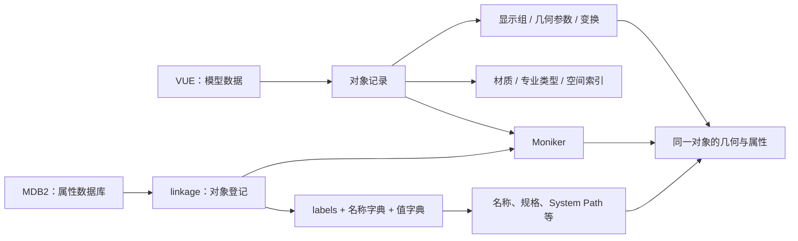
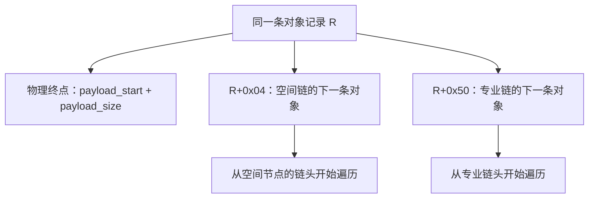
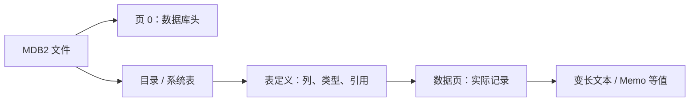
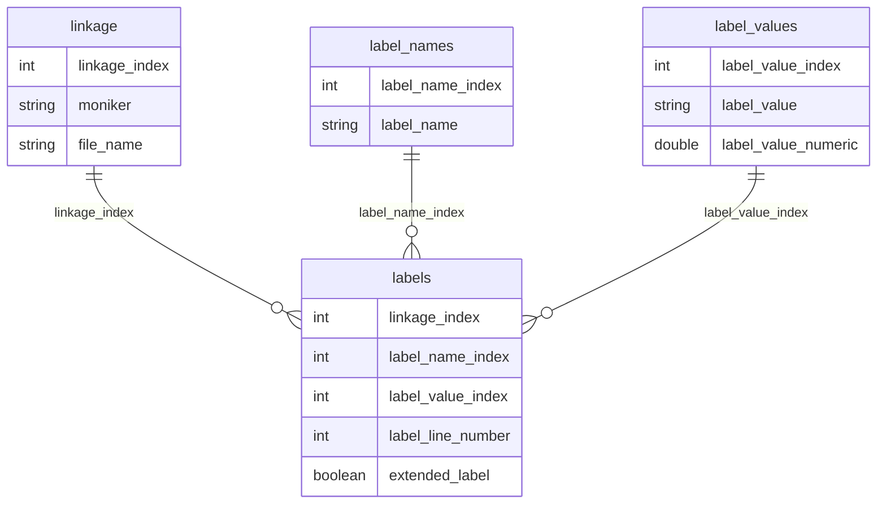
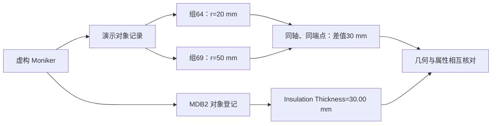

# VUE / MDB2 文件内部结构与解析说明

本文介绍 SmartPlant / Smart 3D 模型文件 `.vue` 和配套属性数据库 `.mdb2` 的**已知内部结构**，并说明参考实现的读取方法。这里的 VUE 是三维模型格式。

可以先把这两个文件想成“模型”和“登记册”：VUE 记录物体的形状、位置、颜色；MDB2 登记物体的名称、规格、所属系统等属性。两者主要通过 **Moniker（对象身份标识）** 对应。

可视化配套：[交互结构图](vue-structure/dist/index.html) · [四页 PDF](vue-structure/dist/VUE_STRUCTURE.pdf) · [SVG 矢量图](vue-structure/dist/VUE_STRUCTURE.svg) · [PNG 总览](vue-structure/dist/VUE_STRUCTURE.png)。页面可离线打开，点击模块查看字段；PDF 完整展开各部分。

字节对照版：[左 HEX / 右说明](vue-structure/dist/hex.html) · [各部分对照 PDF](vue-structure/dist/VUE_HEX_GUIDE.pdf) · [对象头示例 SVG](vue-structure/dist/VUE_HEX_record.svg)。同色对应同一字段，点击可高亮，支持展开完整字节与打印当前部分；数据均为通用或虚构示例。

本文依据参考实现及两组匿名样本的结构核对结果编写，必要时分别称为“样本 A”和“样本 B”。文中的演示数据均注明其示意性质。本文是有样本范围的解析说明，并非厂商公布的完整格式规范。

## 阅读导航

- [1. 适用范围与证据等级](#scope)
- [2. 两个文件如何配合](#overview)
- [3. 读二进制前需要知道的几个概念](#notation)
- [4. VUE 文件头与全局目录](#vue-directory)
- [5. Moniker 字符串与对象定位](#moniker)
- [6. 对象记录头](#record-header)
- [7. 专业、类型、材质和空间索引](#scene-tables)
- [8. 显示组、几何块与变换节点](#display-groups)
- [9. 已知几何参数结构](#geometry)
- [10. 坐标、单位与包围盒的陷阱](#coordinates)
- [11. MDB2 的数据库结构](#mdb2)
- [12. 从 MDB2 还原属性与业务树](#business)
- [13. 演示：读出一根带保温的直管](#example)
- [14. 推荐解析流程与现成命令](#workflow)
- [15. 已知边界与待研究问题](#limitations)
- [附录 A. 通用结构校验表](#validation)
- [附录 B. 字段与源码对照](#sources)

<a id="scope"></a>

## 1. 适用范围与证据等级

文中的“已验证”均指在上述两组样本和相应检查范围内成立。相同文件扩展名、甚至相同版本字符串，也不能代替对指针、长度和类型的校验。

| 标记 | 含义 | 阅读方式 |
| --- | --- | --- |
| **已验证** | 有明确读取代码，且样本中的边界、引用或几何约束通过检查 | 可用于实现这些已观察布局的读取器 |
| **候选** | 有样本或显示效果支持，但完整语义、适用条件尚不充分 | 保留原始值和候选状态，继续核对 |
| **未知 / 原始值** | 知道字段位置或能划定范围，尚不能解释含义 | 保留字节，避免赋予未经证实的业务名称 |
| **导出策略** | 为生成预览、场景树或网格而采用的程序规则 | 不能反推为源文件的存储规定 |

例如，材质表中有可读取的不透明度；但显示码 `69` 的保温组被预览程序设为最多 `0.5` 不透明度，是另一条显示规则。这两件事需要分开描述。

未经过同等结构校验的文件不在已验证范围内，不能仅凭文件头标识相同就认定其所有内部布局都兼容。

<a id="overview"></a>

## 2. 两个文件如何配合



VUE 与 MDB2 的数据量没有一对一的行数关系：

- 一个 VUE 对象可包含多个显示组、多个几何块，最终生成多个网格。
- 一个 MDB2 对象通常对应多条属性行。
- VUE 与 MDB2 应结合导出时间和模型版本核对。不同时间导出期间若发生设计修改，当前两份文件的对象集合就可能暂时对不上；现有样本不能证明两种格式必然存在对象差异。
- `Name` 可以重复；材质编号、数组下标、网格名称也不能替代 Moniker。

还要区分三种“树”：VUE 的**空间树**用于按位置查找物体；VUE 的**几何节点结构**管理几何块与变换；导出结果的**业务树**按 `System Path` 等属性组织对象。它们服务于不同目的。

<a id="notation"></a>

## 3. 读二进制前需要知道的几个概念

### 3.1 偏移、长度和基本数据类型

偏移可以理解为“从文件第几个字节开始”。本文用 `0x` 表示十六进制，例如 `0xB0 = 176`。

| 写法 | 意义 |
| --- | --- |
| `R` | 某条对象记录的起始文件偏移 |
| `G` | 某个显示组的起始文件偏移 |
| `T` | 某个带类型标记的几何块起始偏移，即类型字段所在位置 |
| `N` | 某个嵌套变换节点的头起始偏移 |
| `B = R + 0x70` | 多类内部相对指针使用的基准位置；不是载荷起点 |
| `u32` | 4 字节无符号整数，常用于指针、数量和标志 |
| `f32` / `f64` | 4 / 8 字节浮点数；几何坐标主要使用 `f64` |
| `3d` / `6d` / `16d` | 3 / 6 / 16 个 `f64`，分别占 24 / 48 / 128 字节 |
| `[lo, hi)` | 从 `lo` 到 `hi` 之前的区间；长度为 `hi - lo` |

已解析布局的 VUE 数值采用**小端序**：低位字节在前。例如 `12 00 00 00` 按 `<I` 读取为 `0x12`。Python 的 `struct.unpack_from('<6d', data, offset)` 表示从指定位置读取 6 个小端双精度数。

### 3.2 最容易混淆的是“指针从哪里算”

指针通常只是存储在文件中的数值，并非程序运行时的内存地址。

| 来源 | 已知解释 | 目标位置计算 |
| --- | --- | --- |
| 全局目录的表地址、`R+0x3C` 材质指针、`R+0x8C` Moniker 指针 | 文件绝对偏移 | `target = value` |
| 显示组链表的 `first / last / next` | 相对 `B` 的偏移 | `target = R + 0x70 + value` |
| 已支持的轮廓、边界描述符指针 | 相对 `B` 的偏移 | `target = R + 0x70 + value`，再验证落在所属块内 |
| 嵌套节点 `N+0x10` 的非零后继链接 | 指向后继节点的 8 字节前缀，基准为 `B` | 后继节点头为 `R + 0x78 + value` |
| 部分 `0x18` 曲面数组指针 | 相对曲面内部头 `T+0x50` | `target = T + 0x50 + value`，仅限已校核变体 |
| `discipline_index`、局部序号、类型 ID | 索引或编号 | 按表或键查找，不能直接当作字节地址 |

因此，“所有指针都相对对象头”或“所有指针都为绝对地址”均会读错。

### 3.3 包围盒是什么

包围盒是用来描述物体大致范围的轴对齐长方体。常见字段顺序为：

```text
[xmin, ymin, zmin, xmax, ymax, zmax]   # 6 个 f64，共 48 字节
```

它适合检查位置和范围，但不包含完整形状。圆柱、阀门和一组面片可以具有相同的包围盒。部分几何块存的还是抽样范围或缓存范围，不能仅凭它恢复真实实体。

<a id="vue-directory"></a>

## 4. VUE 文件头与全局目录

### 4.1 文件开头的可读标识

两份主要样本均可在固定位置读到以零字节结束的 ASCII 文本：

| 文件偏移 | 实际内容 | 可确认的作用 |
| --- | --- | --- |
| `0x000` | `SmartPlant Review` | 文件家族标识 |
| `0x040` | `SmartPlant3D` | 来源产品标识 |
| `0x080` | `06.02.00.17` | 文件头中的版本字符串 |

这些文字周围有填充和其他头数据。本文没有给整个前导区定义完整结构；也不把 `06.02.00.17` 等同于 MDB2 的 Jet 版本或数据库业务模式版本。

### 4.2 全局目录中已读出的字段

下面的偏移均相对**文件起点**，字段均为 `u32`。目录告诉读取器“表从哪里开始、有多少项”，类似书的目录。

| 文件偏移 | 源码名称 | 含义 |
| --- | --- | --- |
| `0x52C` | `type_buckets` | 按专业查找类型桶的表起点 |
| `0x530` | `type_entries` | 类型条目区起点；每项 16 字节 |
| `0x534` | `type_strings` | 类型名称字符串池起点 |
| `0x538` | `type_strings_end` | 类型名称字符串池终点 |
| `0x53C` | `spatial_start` | 空间节点表起点 |
| `0x540` | `spatial_end` | 空间节点表终点 |
| `0x548` | `material_start` | 材质槽位表起点 |
| `0x54C` | `material_end` | 材质槽位表终点 |
| `0x558` | `names` | 模型名和专业名指针表起点 |
| `0x564` | `discipline_roots` | 各专业对象链表的首记录指针表起点 |
| `0x588` | `first_record` | 第一条对象记录的文件偏移 |
| `0x594` | `type_count_plus_one` | 已访问类型总数加 1 |
| `0x5A4` | `name_count` | 名称数量，含第 0 项模型名 |
| `0x5A8` | `record_count_plus_one` | 对象记录总数加 1 |

`+1` 是样本中通过总量核对的存储规则。它不证明额外存在一条可见对象或一个可见类型。

**目录字段的位置**与**它存储的地址**是两件事。例如，假设文件 `0x53C` 处存的是 `0x8000`，空间表实际从后者开始。这里的表地址为演示值；不同文件中的对应地址会变化。

### 4.3 全文件的组织方式

下面只表示逻辑引用，不意味着所有区域紧密相接、顺序在其他文件中也相同：

```text
文件头与目录
  ├─ 类型桶 → 类型条目 → 类型名称字符串
  ├─ 专业名称与专业链表首指针
  ├─ 空间节点表 → 空间对象链表
  ├─ 材质槽位表
  ├─ Moniker 文本及其引用
  └─ 对象记录 R
       ├─ 固定对象头 [R, R+0xB0)
       └─ 显示载荷 [R+0xB0, record_end)
            └─ 显示组 → 几何块 / 变换节点
```

目前没有为所有表间空隙、未列出的头字段和字符串周边结构赋予含义。解析时应跟随目录和可信边界，避免把未解释区域自动标成“全为保留字节”。

<a id="moniker"></a>

## 5. Moniker 字符串与对象定位

### 5.1 原始文本与展示键

已观察 Moniker 使用以下零结尾字符串形式，开头有一个空格。下面的数字是虚构示例：

```text
 @a=0001!!10001##123456789012345678\0
```

参考读取器用字节串 `b" @a="` 搜索候选文本，再读到第一个 `\0`。用于匹配和显示时进行以下归一化：

```text
原始文本：  @a=0001!!10001##123456789012345678
去掉首尾空白与 @a=，将首个 !!、## 分别替换为 -
展示键：   0001-10001-123456789012345678
```

这是一条**匹配规则**。Moniker 的各段数字没有在此被完整解释，尤其不能把它直接拆成材质编号、空间坐标或全局类型 ID。应保留原始文本，并把长数字当作字符串，以免经过 JavaScript 数值等路径时损失精度。

### 5.2 从字符串反查对象头

当前研究读取器采用交叉验证，而非仅搜索 `0x12`：

1. 收集 Moniker 文本及其文件偏移 `token_offset`。
2. 按 4 字节网格扫描文件，查找值等于 `token_offset` 的 `u32` 引用。
3. 若引用位于 `p`，尝试 `R = p - 0x8C`。
4. 检查 `R` 处为 `12 00 00 00`，再校验记录头、载荷范围和显示组。

同一字符串可能被对象头之外的结构引用，因此不能直接拿第一个引用当对象。字符串本身也不必按 4 字节对齐；对齐扫描的是引用字段。

当前入口依赖这些特征。找不到该形式的 Moniker，并不能据此证明文件中没有几何，只说明它没有被这套定位办法覆盖。

<a id="record-header"></a>

## 6. 对象记录头

### 6.1 固定部分：`[R, R+0xB0)`

对象头可理解为每件物体的“索引卡”：指向自己的形状、身份、材质和索引位置。下表合并了基础头读取器和场景表读取器的已知解释。

| 相对 `R` 偏移 | 类型 / 长度 | 已知含义或处理方式 |
| --- | --- | --- |
| `+0x00` | `u32` | 对象记录标记 `0x12` |
| `+0x04` | `u32` | 同一空间对象链中的下一条记录地址；`0` 表示链尾 |
| `+0x08` | `6d`，48 字节 | 对象世界包围盒 |
| `+0x38` | 4 字节 | 未解释，保留原始值 |
| `+0x3C` | `u32` | 材质条目绝对地址 |
| `+0x40` | 4 字节 | 未解释 |
| `+0x44` | `u32` | 当前支持布局中等于 `R+0x90` |
| `+0x48` | 4 字节 | 未解释 |
| `+0x4C` | `u32` | 所属空间节点的绝对地址 |
| `+0x50` | `u32` | 同专业对象链中的下一条记录地址；`0` 为链尾 |
| `+0x54` | `u32` | 专业内局部序号；同专业内构成 `0..n-1` 的排列 |
| `[+0x58, +0x6C)` | 20 字节 | 尚未完整解释 |
| `+0x6C` | `u32` | 显示载荷大小 `payload_size` |
| `+0x70` | `u32` | 显示载荷绝对地址；当前布局为 `R+0xB0` |
| `[+0x74, +0x8C)` | 24 字节 | 部分解释：其中 `+0x77` 单字节加 1 得到专业内类型 ID；其余位义未完整解释 |
| `+0x8C` | `u32` | Moniker 字符串绝对地址 |
| `+0x90` | `u32` | 全局序号 |
| `[+0x94, +0xAC)` | 24 字节 | 未完整解释 |
| `+0xAC` | `u32` | 全局序号的重复值，应等于 `+0x90` |

基础模块 `vue_record_parser.py` 会把一些范围整体保存为原始十六进制；后续 `vue_scene_tables.py` 再解释其中的材质、专业和序号。**基础输出中处于 raw 范围，不等于整个项目都不知道其含义。**

### 6.2 正确计算记录结束位置

```text
payload_start = u32(R + 0x70)
payload_size  = u32(R + 0x6C)
record_end    = payload_start + payload_size
```

当前支持布局应满足：

```text
payload_start == R + 0xB0
u32(R + 0x44) == R + 0x90
payload_size >= 16
record_end <= 文件大小
u32(R + 0x04) 为 0，或等于 record_end
```

在已核对样本中，每条记录的物理终点都与下一条已发现记录的起点或文件末尾一致。但 `R+0x04` 也会为零，仍然必须读完对应记录，不能把空链接当作没有载荷。

**不能用 `R+0x50` 计算记录终点。** 它是专业链指针，可能跳过其他专业的记录；恰好等于物理终点只是某些记录相邻造成的数值重合。



同一个对象同时出现在不同索引链中，是文件用不同方式查找同一批对象的结果。

<a id="scene-tables"></a>

## 7. 专业、类型、材质和空间索引

### 7.1 名称表与专业类型表

`names` 处先放 `name_count` 个 `u32` 字符串指针；当前读取器要求字符串位于指针数组之后、`discipline_roots` 之前，并以零结束。第 0 项是模型名，后续项是专业名，如 `Piping`、`Equipment`、`Structure`。

专业索引从 `1` 开始。对专业 `i`：

```text
bucket = u32(type_buckets + 4*i)
bucket 内部：u32 首类型条目指针 + u32 类型数量

每个类型条目，共 16 字节：
  +0x00  u32  下一条类型条目地址
  +0x04  u32  类型名称字符串地址
  +0x08  u32  type_id
  +0x0C  u32  ordinal 原始序号字段
```

条目按链接遍历，并与声明数量、零结尾和完整表覆盖情况核对。`type_id` 的查找键是 **`(专业索引, type_id)`**；不能只使用一个全局整数查所有专业。

对象类型的三重核对为：

```text
type_id = data[R + 0x77] + 1
材质.packed_code_raw & 0x1FF == 2 * type_id
类型表中存在 (对象所属专业, type_id)
```

`discipline_roots + 4*i` 保存该专业首对象的绝对地址，随后沿对象 `R+0x50` 遍历。样本检查要求所有对象被恰好一个专业链覆盖，且材质专业与链表专业一致。

这里的 `Pipe`、`Weld` 等是 VUE 原生类型名。它们与 MDB2 的 `Name`、`Type` 等业务标签应分别保存；相似名称不代表字段来源相同。

### 7.2 材质表：每个槽位 200 字节，即 `0xC8`

区间为 `[material_start, material_end)`，长度必须能被 200 整除。其中有全零空槽，不能把每个槽位都视为有效材质。

以下偏移相对材质条目起点 `M`：

| 偏移 | 类型 | 已知内容 |
| --- | --- | --- |
| `+0x00` | `u32` | 打包编码；低 9 位与对象类型满足上述关系，完整位义未解释 |
| `+0x04` | `u32` | 专业索引 |
| `+0x1C` | `u32` | 当前槽位的自索引，应等于 `(M-material_start)/200` |
| `+0x24` | `u32` | 打包颜色原始值，保留；不依赖它代替已读 RGB |
| `+0x28` | `u32` | 原始标志 |
| `+0x30` | `3f` | 漫反射 RGB，即主要显示颜色 |
| `+0x3C` | `3f` | 高光 RGB |
| `+0x48` | `3f` | 环境光 RGB |
| `+0x54` | `f32` | 不透明度 `opacity`：`1` 完全不透明，`0.5` 半透明 |
| `+0x58` | `3f` | 漫反射 RGB 的重复值 |
| `+0x64` | `f32` | 不透明度的重复值 |
| `+0xC4` | `u32` | 原始字段，完整意义未解释 |

未列出的区域仍须保留。源码还报告 `(packed_code & 0x1FF)//2` 的类型候选和 `packed_code >> 9` 的颜色索引候选；后者的完整编码没有在本文确认为通用规则。

实际读取需校验 RGB 和不透明度有限、落在 `[0,1]`，重复字段一致，材质指针落在有效网格且指向已占用槽位。透明度按 `1-opacity` 得到。

### 7.3 空间表：每个节点 120 字节，即 `0x78`

这是一棵已通过结构检查的八叉空间树：一个立方体可以继续分成八个半边长立方体。它用于按区域组织对象。

以下偏移相对空间节点 `S`：

| 偏移 | 类型 | 已知内容 |
| --- | --- | --- |
| `+0x00` | `u32` | 节点标记 `8` |
| `+0x04` | `u32` | 第一类空间对象链的首对象地址 |
| `+0x08` | `6d` | 节点世界包围盒，样本中为立方体 |
| `+0x38` | `u32` | 第二类空间对象链的首对象地址 |
| `+0x3C` | `8I` | 八个子空间节点的绝对地址；`0` 表示该槽无子节点 |
| `+0x5C` | 4 字节 | 未解释 |
| `+0x60` | `3d` | 立方体中心，应等于包围盒两端的平均值 |

两类对象链都沿对象头 `R+0x04` 遍历，但“两类”的进一步业务含义尚未确认。每个对象的 `R+0x4C` 应反向指回所属空间节点。

子槽位与半空间的对应关系在两份样本中一致。下表中的 `0/1` 表示沿该坐标轴位于父中心的低 / 高半区：

| 子槽位 | X 半区 | Y 半区 | Z 半区 |
| --- | --- | --- | --- |
| 0 | 0 | 0 | 0 |
| 1 | 0 | 0 | 1 |
| 2 | 0 | 1 | 0 |
| 3 | 0 | 1 | 1 |
| 4 | 1 | 0 | 0 |
| 5 | 1 | 0 | 1 |
| 6 | 1 | 1 | 0 |
| 7 | 1 | 1 | 1 |

当前读取器还核对唯一根节点为 `spatial_start`、无环、所有节点可达、子格边长减半、对象只归属一个空间链，以及对象包围盒被所属格包含。

<a id="display-groups"></a>

## 8. 显示组、几何块与变换节点

### 8.1 对象载荷有两种已知入口

**直接根组 `direct_root`：** 若 `u32(R+0xBC) == 10`，则 `G=R+0xB0`。当前实现只支持其 `G+0x08` 链接为零的情况。

**根组列表 `root_list`：** 在 `R+0xB0` 处读取四个 `u32`：

| 顺序 | 名称 | 解释 |
| --- | --- | --- |
| 1 | `first` | 首显示组的相对指针，基于 `B=R+0x70` |
| 2 | `last` | 尾显示组的相对指针，使用同一基准 |
| 3 | `storage_tail` | 原始存储尾字段；当前遍历不依赖它解释边界 |
| 4 | `count` | 显示组数 |

首组为 `G=B+first`，后继相对指针位于 `G+0x08`。读取器检查无环、数量与尾指针一致、组地址递增且落在对象内。当前接受 `1..10000` 个组；这是实现限制，并非已证实的格式上限。

每个组的可信区间由“当前组起点到下一组起点”，或最后一组到 `record_end` 确定。不能不加区分地把组内某个 `size_raw` 当作全部跨度。

### 8.2 显示组的已知字段

| 相对 `G` 偏移 | 类型 / 范围 | 已知内容 |
| --- | --- | --- |
| `+0x00`、`+0x04` | 各 `u32` | 组内引用原始字段，尚未完整解释 |
| `+0x08` | `u32` | 下一显示组的相对链接；零为链尾 |
| `+0x0C` | `u32` | 显示组类型 `10`，即 `0x0A` |
| `+0x10` | `u32` | 大小原始字段 `size_raw` |
| `[+0x14, +0x20)` | 12 字节 | 原始字段 |
| `+0x20` | `u32` | 显示码 `display_code_raw` |
| `+0x24` | 4 字节 | 原始字段 |
| `+0x28` | `6d` | 组的世界包围盒 |
| `[+0x58, +0x78)` | 32 字节 | 未完整解释 |
| `+0x78` | `16d` | 矩阵 A，4×4，按行存储 |
| `+0xF8` | `16d` | 矩阵 B，与 A 互逆 |
| `+0x178` | `6d` | 缓存包围盒候选，不能直接再作一次世界变换 |
| `[+0x1A8, +0x1E0)` | 56 字节 | 未完整解释 |
| `+0x1E0` 起 | 变长 | 组的元素区，可有标记几何块与变换节点 |

前 88 字节是基础组头，完整的已观察前置区一直延伸到 `G+0x1E0`。两份样本所有根组的矩阵对均能读出并通过互逆检查。

| 显示码 | 样本解释 | 注意 |
| --- | --- | --- |
| `64`，即 `0x40` | 主显示 / 本体候选 | 不代表几何一定是直管 |
| `69`，即 `0x45` | 保温显示组候选，在样本 A 有几何与厚度属性交叉验证 | 不透明度不存放在这个码中 |
| `0` | 主要出现在两样本的直接根组 | 保留原始分类，不擅自命名 |

样本 B 未出现显示码 `69`。因此，不能用“缺少 69”判断所有文件中的对象都没有保温；保温的组织方式不应强制统一成一种布局。

### 8.3 几何标记块的边界

标记块从 `T` 开始，先读取：

```text
T+0x00   u32 type
T+0x04   u32 size
T+0x08   该几何布局的后续数据，常先是 6d 包围盒
```

本文沿用源码的签名写法：**类型用十六进制，大小用十进制**，例如 `0x1F/208`。`208 = 0xD0`。仅比较类型码不够：`0x1F/208` 和 `0x1F/264` 的参数结构不同。

当前元素遍历规则为：

- 通常按 `size` 前进；`size` 至少为 8，且是 8 的倍数。
- 若末块的 `T+size` 恰好超过当前区间末尾 8 字节，则允许实际到 `T+size-8` 结束，记录为 `tail_no_framing`。
- 其他越界或无法识别的封装报告缺口，不能向区间外继续猜读。

末尾的 8 字节差异是观察到的封装规则，尚不足以为所有尾字节赋予统一语义。例如 `0x1F/208` 的已知参数读到 `T+0xC8` 之前，正好 200 字节，不能因此将所有声明为 208 的块都改名为 200 字节块。

两份样本的根组遍历均能到达合法终点，**这只证明元素边界可遍历，不证明每种元素的几何语义已解出**。

### 8.4 嵌套变换节点

元素区还会出现矩阵节点。当前识别特征是头三个 `u32` 为 `(a,0,0)` 且 `a>0x100`，随后进行跨度、指针和矩阵检查，不能仅凭这个特征接受节点。

| 相对 `N` 偏移 | 内容 |
| --- | --- |
| `+0x00` 起，24 字节 | 六个 `u32`：`(a,0,0,ptr1,ptr2,0)` 的已观察形式，部分字段语义仍为原始值 |
| `+0x10` | 上表的 `ptr2`，非零时链接后继节点 |
| `+0x18` | 4×4 `f64` 矩阵 A，占 128 字节 |
| `+0x98` | 4×4 `f64` 矩阵 B，占 128 字节，与 A 互逆 |
| `+0x118`、`+0x130` | 各 3 个 `f64`，以世界点原始字段保留，完整用途未确认 |
| `+0x180` | 当前节点直接拥有的子元素区起点 |

当前边界关系：

```text
若 ptr2 != 0：
    next_N = R + 0x78 + ptr2
    node_end = next_N
    node_end - N 应等于 a + 4
若 ptr2 == 0：
    node_end = 当前所属区间终点
    node_end - N 应等于 a - 4
```

读取器支持按有界区间递归遍历；已核对样本中的节点主要是组内节点及其同级串联，复核没有发现带更深父节点的实例。因此，不能用现有样本证明任意深度的组合变换均受支持。

每个节点只把矩阵绑定给自己直接拥有的几何块。把第一个节点的矩阵套在后续所有圆柱上，会导致同一对象内部零件错位。对于已支持布局，程序按所属节点选用矩阵；没有把任意父子矩阵累乘认定为通用规则。

<a id="geometry"></a>

## 9. 已知几何参数结构

VUE 并非只存顶点和三角形。当前已知布局中有大量圆柱参数、拉伸轮廓、曲线边界和样条控制网。程序需要把这些参数计算成可显示的网格。

### 9.0 图元形状速览

下面按已知布局原创绘制 16 幅示意图，先看形状，再理解中心、半径、轴向、轮廓和控制点分别起什么作用。


[放大浏览图元](vue-structure/dist/primitives.html) · [SVG 矢量图](vue-structure/dist/VUE_PRIMITIVES.svg) · [单页图例 PDF](vue-structure/dist/VUE_PRIMITIVES.pdf) · [图例与 HEX 完整 PDF](vue-structure/dist/VUE_HEX_ILLUSTRATED.pdf)。HEX 对照页也可展开这组图例。

图中的 `type` 是顶层块类型，`kind` 是边界实体类别；“显示网格”指这里的导出三角化结果。三者属于不同层次。图例用于解释形状与参数，不是厂商完整类型表，也不表示同名图元的所有变体均已支持；源网格编码不在这组图例中作额外推断。

### 9.1 已有解码分支的主要签名

以下是当前源码的支持范围概览。**“有分支”表示能识别并尝试该布局，仍需通过内部指针、参数、边界等校验，不是同签名任意数据都已完整支持。**

| 签名：类型 / 十进制大小 | 已知解释或当前处理 |
| --- | --- |
| `0x1F/208` | 有限圆柱；零高度时可形成圆盘类几何 |
| `0x1F/264` | 四点轮廓拉伸的长方体候选，保留候选标记 |
| `0x1F/464`、`720`、`2192` | 特定曲带、阶梯、护笼圈等轮廓拉伸布局 |
| `0x1F/640`、`848` | 由线段 / 圆弧轮廓组成的拉伸面或封闭拉伸体 |
| 其他已校验的 `0x1F` 变长块 | 通用受限轮廓分支，可处理直接闭合折线或计数复合边界；不代表任意大小都支持 |
| `0x1D/224` | 未裁剪球面参数 |
| `0x1E/232` | 完整圆环面参数 |
| `0x17/424` | 圆锥侧面，带圆边界与顶点 |
| `0x17/440` | 可为圆台侧面，也可为等半径圆柱孔壁，需继续检查内部布局 |
| `0x17/1464` | 由两条有理闭合边界曲线限定的圆柱面 |
| `0x18/752`、`760`、`2128`、`2464`、`2288`、`2488` | B 样条 / 有理 B 样条曲面控制网 |
| `0x20/240` | 圆弧扫掠管；有完整原生参数路径，也有受限候选回退路径 |
| `0x20/256` | 已支持椭球封头和另一类旋转圆弧面，依内部边界区分 |
| `0x20/296`、`320`、`344`、`768` | 已观察的原生折线 / 圆弧 / 样条轮廓旋转或扫掠布局 |
| `0x20/352`、`392`、`416`、`464` | 受限旋转轮廓实体、旋转表面或曲带面布局 |
| `0x21/280` | 两个圆之间的直纹过渡面，可对应偏心异径管侧面 |
| `0x21/392`、`440` | 两条闭合四边形轮廓间的直纹结构，当前分支构造侧面和端面 |
| `0x0E/312`、`368`、`408` | 圆面、折线边界面、环形面等已知变体 |
| `0x0E/440`、`456`、`512`、`656` | 特定平面多边形 / 四边形布局 |
| `0x0E/1432`、`3528` | 已知带孔面布局；后者需结合楼板同一作用域的边界和孔壁 |
| `0x0E/584` | 可能是实际面，也可能是已由其他曲面表达的边界引用，需检查内部字段 |
| 其他已校验的 `0x0E` 变长块 | 按闭合环表和边界描述符尝试平面面片读取 |
| `0x04/200`、`224` | 特定三角形 / 四边形薄板轮廓，厚度由已观察包围盒范围恢复 |
| `0x0F/168`、`0x28/112`、`0x03/152` | 参考圆、点 / 线等参考信息；不能直接算作独立实体面 |

“阶梯”“护笼”等名称说明已观察的应用场景，不代表文件中同一类型码只服务于该业务类别。以 `0x17/440` 为例，**连类型和大小都相同，内部结构仍可能分成多种变体**。

### 9.2 圆柱：`0x1F/208`，即 `0x1F/0xD0`

这是直管读取器的核心布局。以下偏移相对 `T`：

| 偏移 | 类型 | 含义 |
| --- | --- | --- |
| `+0x00` / `+0x04` | 各 `u32` | `type=0x1F`、`size=208` |
| `+0x08` | `6d` | 几何块包围盒；已支持嵌套实例中可已是世界范围 |
| `+0x38` | `u32` | 序号原始字段 `seq` |
| `+0x50` | `3d` | 轴向位移向量 `axis`，其长度包含高度 |
| `+0x78` | `3d` | 一个端面中心 `point` |
| `+0x90` | `3d` | 轴向参考方向 `dirv` |
| `+0xA8` | `3d` | 径向参考向量 `refvec`，其模长为半径 |

其他间隙和尾字段尚未全部解释。关键关系为：

```text
端点 p1 = point
端点 p2 = point + axis
长度 h  = sqrt(axis.x² + axis.y² + axis.z²)
半径 r  = sqrt(refvec.x² + refvec.y² + refvec.z²)
```

不能把 `axis` 当单位方向，也不能只读取 `refvec.x` 当半径；旋转后半径分量可能分布在三个坐标上。零高度圆柱可表示圆盘类片段，因此不宜一概删去所有短柱。

直管语义还需要先区分本体与保温，再按半径与长度归组。当前 `merge_main_pipe` 使用半径差 2 mm 以内的分组、按总高度选主管；它实际累加段长，并未执行严格的共轴区间并集。这是**直管研究启发式**，不是几何格式规则，也不能泛化为通用法兰或密封面识别规范。

### 9.3 轮廓、边界实体与拉伸

可以把轮廓拉伸想成：先画一个闭合截面，再沿一个向量把它拉出厚度。

#### 9.3.1 原生边界描述符

多种面和拉伸体共用 8 字节描述符：

```text
u32 pointer + u32 kind
实体数据地址 = R + 0x70 + pointer
```

这里的 `kind` 是**边界实体类别**，与顶层块的 `type` 属于不同上下文，不能混成同一张类型表。

| `kind` | 已知数据结构 |
| --- | --- |
| `3` | 64 字节直线段实体：`+0x00 point(3d)`、`+0x18 direction(3d)`、`+0x30 start(f64)`、`+0x38 end(f64)`；`p(t)=point+direction*t` |
| `16` | 96 字节椭圆弧实体：`+0x00 center(3d)`、`+0x18 normal(3d)`、`+0x30 major(3d)`、`+0x48 ratio/start/end(3d)` |
| `15` | 80 字节圆边界：中心、轴向、径向向量各 `3d`，以及 `+0x48` 的半轴比；当前圆分支要求比值约为 1 |
| `4` | 折线引用；描述符后有点数组指针和数量，已支持布局中的点数据位于该折线内部头之后 16 字节 |
| `12` | 已支持复合边界入口；再引用环表或实体序列，不是固定大小的单个点数组 |

椭圆弧可写为 `center + major*cos(t) + minor*sin(t)`，其中次半轴方向来自 `normal × major`，其长度再乘 `ratio`。读取时要验证方向、参数区间、边连接和闭合，不能把描述符后所有双精度数直接当顶点。

#### 9.3.2 平面环表

`planar_loops_from_vue` 支持的 `0x0E` 布局中：

| 相对 `T` 偏移 | 内容 |
| --- | --- |
| `+0x50` | 平面上的点，`3d` |
| `+0x68` | 平面法向，`3d` |
| `+0x98` | `u32 环表相对指针 + u32 环数量` |
| `+0xC8` | 已支持布局的环表实际起点 |

每个环表项 12 字节：`(描述符相对指针, 边数, flags)`，当前已支持标志为 `256`。环的描述符指向前述线段、圆弧、圆或折线。

这能表达外边界和孔洞。生成面片时需保留孔，不能仅对所有点做一个凸包或把每个环各自填满。

#### 9.3.3 拉伸块

已支持的通用 `0x1F` 轮廓布局中，`T+0x50` 为 `3d` 拉伸向量；`T+0x68` 为轮廓相对指针，`T+0x6C` 为标志。当前以 `flags & 0x10000` 区分需要封闭端盖的实体分支与表面分支。

对 `0x1F/264`，候选布局从 `T+0x88` 读取闭合点列，并结合拉伸向量构造长方体。该路径仍输出 `tentative=True`，不能因已生成网格就把所有该签名布局宣布为完全解码。

### 9.4 圆弧扫掠管：`0x20/240`

可以把弯头想成“一个圆形截面沿一段圆弧移动”。完整原生参数路径读取：

| 相对 `T` 偏移 | 类型 | 含义 |
| --- | --- | --- |
| `+0x50` | `3d` | 圆弧中心 `C` |
| `+0x68` | `3d` | 圆弧平面单位法向 |
| `+0x80` | `f64` | 扫掠角，按弧度解释 |
| `+0x98` | `3d` | 起始端面的中心 `S` |
| `+0xB0` | `3d` | 起始端处的切向参考单位向量 `v` |
| `+0xC8` | `3d` | 管截面半径向量，取模得到截面半径 `r` |

令 `R_arc=|S-C|`、`u=(S-C)/R_arc`，则中心线为：

```text
centerline(t) = C + R_arc * (cos(t)*u + sin(t)*v)
```

这里有两个不同半径：`R_arc` 控制弯曲，`r` 控制管粗细。当前半径读取使用 `T+0xC8` 起三个分量的模长；只固定取 `+0xC8` 或 `+0xD0` 单个浮点数都不适用于所有方向。

若原生参数路径失败，预览程序还可能尝试受包围盒约束的 `arc_tube_candidate`。候选回退的解释强度低于完整参数路径，应单独标记。

对 VUE 原生类型为 `Weld` 的已识别圆环，当前导出器显示中心线圆周，并标记虚拟显示几何；这是一条预览策略，不能用来证明源数据只包含一条线。

### 9.5 球、圆环面、圆锥与圆台

| 布局 | 相对 `T` 的主要参数 | 必须保留的限制 |
| --- | --- | --- |
| `0x1D/224` 球 | `+0x50 center(3d)`、`+0x68 axis(3d)`、`+0x80 radial(3d)`、`+0x98 radius(f64)` | 当前支持未裁剪变体；需检查后续标志和零区 |
| `0x1E/232` 圆环面 | 与球类似的中心与参考方向，`+0x98 major_radius(f64)`、`+0xA0 tube_radius(f64)` | 当前要求 `0<tube_radius<major_radius`、正交单位框架及未裁剪标志 |
| `0x17/424` 圆锥面 | `+0x50 base(3d)`、`+0x68 axis(3d)`、`+0x80 radial(3d)`、`+0xA0 sine/cosine(2d)`、`+0x160 apex(3d)` | 需验证圆与直线边界引用、顶点共轴及锥度相容 |
| `0x17/440` 圆台面 | 第一端框架同上；第二端中心、轴与径向向量在 `+0x160/+0x178/+0x190` | 需结合两个圆边界及锥度验证，不能仅按大小判为圆台 |

`0x17/440` 的另一变体用两条等半径圆边界表达圆柱孔壁。两处边界描述符在 `T+0x100`、`T+0x158`，分别引用 `T+0x108`、`T+0x160`。还需检查同轴、半径、方向与所在楼板作用域。

`0x17/1464` 则包含两条二次有理闭合曲线，各有 13 个控制点与 16 个节点值。其指针链、径向对应和参数反向关系都有专门检查；不能用普通两端平行圆环替换这类斜切边界。

### 9.6 样条曲面：`0x18` 的已知布局

这类数据可以理解成“一张由控制点拉出形状的曲面”。控制点、权重和节点向量共同决定曲面，不等同于直接可显示的三角网格。

| 相对 `T` 偏移 | 内容 |
| --- | --- |
| `+0x68` | `u32 nu`，U 向控制点数 |
| `+0x6C` | `u32 nv`，V 向控制点数 |
| `+0x70` | `u32 knot_u_count` |
| `+0x74` | `u32 knot_v_count` |
| `+0xC0` 起 | `nu*nv` 个控制点，每点 `3d`，共 `24*nu*nv` 字节 |
| 控制点之后 | 有理变体中每点一个 `f64` 权重 |
| 再之后 | U 向节点数组，然后 V 向节点数组，每值 `f64` |

当前内存视图按 `(nv,nu,3)` 解释控制网。`752` 字节变体为非有理布局；`760/2128/2464/2288/2488` 字节变体带权重。

```text
point_end = T + 0xC0 + 24*nu*nv
若为有理曲面：knot_start = point_end + 8*nu*nv
否则：        knot_start = point_end

degree_u = knot_u_count - nu - 1
degree_v = knot_v_count - nv - 1
```

需要检查所有数组在块内、权重大于零、节点非递减、次数与控制点数量相容。`2288/2488` 变体还会核对 `T+0x50` 的四个数组相对指针。

生成显示网格要在曲面参数域采样。这些采样密度由实现选择，不能记为源文件“原有三角形数量”。类似地，部分布局中的“扶手”“阶梯”等名字来自样本用途，而非曲面数学类型的唯一名称。

### 9.7 旋转轮廓与直纹过渡

旋转面是把一条轮廓绕轴转动得到的形状；直纹面则是连接两条边界上对应点的一族直线。两者虽然可能都用于接头或设备，存储方式不同。

#### 9.7.1 `0x20` 旋转族的轴与轮廓

多个已支持旋转布局共享 `T+0x50` 的轴上点、`T+0x68` 的轴方向，以及 `T+0x80` 的旋转角，但后面的轮廓表示不同：

| 布局 | 已知轮廓入口与限制 |
| --- | --- |
| `0x20/256` | `T+0x90` 为 `(相对指针,kind=16)`，引用 `T+0x98` 的椭圆弧；椭圆中心 / 法向 / 主半轴分别在 `+0x98/+0xB0/+0xC8`，比值和起止角在 `+0xE0` 起 |
| `0x20/320`、`344` | `T+0x88` 指向 `T+0x90` 的折线描述符；`T+0x98` 给出点数组指针和数量，`T+0xA8` 起分别为 6 / 7 个三维点 |
| `0x20/296` | `T+0x88` 引用 `T+0x90` 的原生闭合折线描述符，按折线规则追踪点数组 |
| `0x20/768` | `T+0x90` 为 `kind=27` 的样条描述符；`T+0x98` 的三个相对指针引用 `+0xC8/+0x200/+0x268` 的控制点 / 权重 / 节点数组；`T+0xB0` 声明 13 控制点、18 节点值 |
| `0x20/352`、`392` | 从 `T+0x88` 后的描述符区识别已校验的线段 / 圆弧母线链，再绕声明轴旋转 |

上述相对指针均按 `B=R+0x70` 解引用，并检查实际目标与布局相符。`0x20/256` 中，椭球封头分支还要求 `2π` 旋转、特定四分之一椭圆弧及轴向关系；不满足这些条件时，另一个受限旋转圆弧分支可能仍适用。不能把全部 `/256` 都当椭球。

`0x20/416` 是一项需要单列的布局：`T+0x88` 的轮廓引用经 `+0x90/+0x98` 继续连接，在 `T+0xA0` 起存 10 个 `3d` 母线点。已观察点采用 `(0,半径,Z)` 坐标，旋转角为 `2π`。当前实现用所属组矩阵的**平移**提供原点，保留母线已有的世界对齐方向，不把组旋转再次叠加。

旋转轮廓的端点若落在轴上，需要收拢为极点；完整一圈需要共享接缝。部分旋转与开放母线能否加端盖，要依据原生边界和实体条件，不能统一补洞。

#### 9.7.2 `0x21` 的已支持双边界布局

`0x21/280` 在 `T+0x60` 和 `T+0xB8` 放置 `kind=15` 的圆描述符，分别引用 `T+0x68` 和 `T+0xC0` 的圆实体。每圆包含中心、轴、径向向量和半轴比。两端圆可有不同半径和横向中心偏移；当前分支验证方向和轴向距离后连接对应圆周，生成过渡侧面。

`0x21/392`、`440` 在 `T+0x50` 起放两个相对指针，指向两条折线描述符：

```text
/392：第一描述符 T+0x60，第二描述符 T+0xF0
/440：第一描述符 T+0x60，第二描述符 T+0x108
```

两条闭合折线去掉重复终点后都应恰有四个角点。当前实现连接对应边，再分别三角化两端，检查封闭性。更大的 `0x21` 块包含其他复杂边界，不能将这两种点数组布局直接套用过去。

### 9.8 参考几何的含义

参考圆、参考边界和点线可以辅助限定曲面，但未必需要再生成实体。当前程序会检查参考采样点是否被已解曲面覆盖；未覆盖者可生成诊断包围盒。

“参考未覆盖”只表示当前检查找不到对应表面；它与“源模型一定缺面”“应把参考圆填成圆盘”不是同一个结论。`0x0E/584` 等块甚至需要先判定是实际面还是边界引用。

<a id="coordinates"></a>

## 10. 坐标、单位与包围盒的陷阱

### 10.1 世界坐标与局部坐标可同时存在

已经核对的直管参数使用世界坐标 `(E,N,EL)`，单位为米，Z 轴向上。但其他零件可在局部原点附近保存参数，再用所属节点矩阵放到实际位置。

**同一个几何块内，点与轴可能是局部数据，包围盒却已是世界数据。** 因此必须分别管理坐标空间。

已支持矩阵采用行向量约定：

```text
[x_world, y_world, z_world, 1] = [x_local, y_local, z_local, 1] @ A

A = [ r00  r01  r02  0 ]
    [ r10  r11  r12  0 ]
    [ r20  r21  r22  0 ]
    [ tx   ty   tz   1 ]
```

平移在最后一行。点需要平移，方向和轴向位移只乘左上 3×3 部分。读取器验证 `A*B≈I`；但“两个矩阵互逆”本身不能证明全部子块都应再应用一次 A。

普通圆柱、节点内圆柱、原生世界曲线等分支的处理不同；部分几何会比较“直接使用”和“应用所属矩阵”两个解释与原始范围的相容性。这些分支选择是当前实现，不能据此随意调整未知数据到包围盒中心。

### 10.2 源包围盒未必等于解析几何的精确范围

对半径为 `r`、轴向单位向量为 `n` 的圆柱，其圆截面沿坐标轴 `i` 的精确半宽为：

```text
r * sqrt(1 - n_i²)
```

若源缓存只取圆周四个参考方位，两个面内单位方向为 `u,v`，则半宽可能只有：

```text
r * max(|u_i|, |v_i|)
```

后者在某些旋转角度下明显偏小。球面、圆弧和曲面也存在抽样包围盒、局部缓存或截断范围的变体。因此：

- 包围盒差大，需要分辨是坐标解释错误、缓存定义不同，还是几何尚未读对。
- 包围盒一致，只能说明范围相容，不能证明曲面、孔洞、拓扑或法向正确。
- 显示网格的包围盒还受采样密度影响，不能让网格粗细决定原生参数是否有效。

### 10.3 模型坐标与导出坐标

CLI 当前默认把 GLB 转为 Y 轴向上：

```text
源坐标 (E, N, EL) → GLB (E, EL, -N)
```

`--glb-up-axis z` 可保留源朝向。OBJ 和 FBX 使用源 Z 轴向上坐标。轴向转换是输出适配；读取 VUE 时不应把它提前混入原始字段解释。

材质不透明度来自 VUE。保温显示组 `69` 另使用 `alpha=min(原材质不透明度,0.5)`；紫红色未知包围盒和焊缝线显示也都是导出策略。

<a id="mdb2"></a>

## 11. MDB2 的数据库结构

### 11.1 物理容器：样本实际是 Jet 4 数据库

`.mdb2` 是这里的文件扩展名，不能理解成“MDB 第 2 版”。两份样本开头均为：

```text
00 01 00 00 53 74 61 6E 64 61 72 64 20 4A 65 74 20 44 42 00
            S  t  a  n  d  a  r  d     J  e  t     D  B
```

`access-parser 0.0.6` 将其识别为 `version=4`、`page_size=4096`。文件 `0x14` 的版本字节为 `0x01`，由该库映射为 Jet 4；每个页号 `p` 对应文件偏移 `p*4096`。



该库按页首 `01 01` 识别数据页、按 `02 01` 识别表定义页，再结合目录和表定义取出记录。它还处理变长列、空值、文本与 Memo 数据等数据库内部封装。

参考实现将 Jet 页解析交给数据库解析库；VUE 的固定字节偏移方法不能直接套到 MDB2 的每一行。对于 MDB2，应先用数据库解析库获得表和列，再解释业务关系。下文的列类型是数据库逻辑类型，不能照表把每行硬拼成固定结构；尤其 Boolean 的行内存储也不能仅据声明长度推断。

已核对的数据库目录同时包含以 `MSys` 开头的系统表和业务表。当前业务加载只需其中四张核心表；不能因此说数据库“只有四张表”，也不应假设所有文件的表数量相同。

### 11.2 四张核心表与引用关系



图表示已核对的**逻辑引用关系**，不表示已经检查过数据库内所有主键、索引或外键约束声明。程序会自行检查重复键和悬空引用。

#### `linkage`：对象登记表

| 列名 | 样本数据库类型 | 已知作用 |
| --- | --- | --- |
| `linkage_index` | 32 位整数 | 对象登记行的本地标识，供 `labels` 引用 |
| `moniker` | Text | 与 VUE 对象关联的身份文本 |
| `file_name` | Memo / 长文本 | 样本值如 `Piping`、`Equipment`，表现为来源专业名；不应假设总是磁盘路径 |
| `label_file_index` | 32 位整数 | 标签文件 / 分组索引原始值，完整跨文件意义未解释 |
| `DMRSLinkage` | Text | 四段连接键的文本表示；可能存在截断或表示差异，不用它代替 Moniker 关联 |
| `link_key_1..4` | 各 16 位有符号整数 | 四段连接键原始值；可有负数，不能强制改成无符号数 |

`linkage_index` 不是 VUE 的记录地址，也不是 Moniker 中的长整数。不同文件中的同号登记行不表示同一个对象。

直接拼接四段键与 `DMRSLinkage` 比较，已观察到两者不一致的记录。这说明不能依赖文本拼接相等作为所有对象可加载的前提；确切写入原因仍需进一步研究。

#### `labels`：对象与属性的关联表

| 列名 | 样本数据库类型 | 已知作用 |
| --- | --- | --- |
| `linkage_index` | 32 位整数 | 引用 `linkage` |
| `label_name_index` | 32 位整数 | 引用属性名字典 |
| `label_value_index` | 32 位整数 | 引用属性值字典 |
| `label_line_number` | 16 位整数 | 属性行的排序信息 |
| `extended_label` | Boolean | 扩展标签标志；不应直接当作扩展文字内容 |

一条记录相当于：“对象 A 的属性 N 取值 V”。同一对象可以重复出现相同属性名，读取器应保留这些出现次数。

`label_line_number` 与 `label_name_index` 不能互换。已观察到两者不同的属性行，不能因部分记录恰好相等而把排序号当作名称字典键。

#### `label_names`：属性名字典

| 列名 | 样本数据库类型 | 已知作用 |
| --- | --- | --- |
| `label_name_index` | 32 位整数 | 名称字典键 |
| `label_name` | Text | 如 `Name`、`System Path`、`NPD`、`Insulation Thickness` |
| `label_status` | 32 位整数 | 状态原始字段，完整枚举意义未解释 |
| `category_index` | 32 位整数 | 分类索引原始字段 |
| `property_index` | 32 位整数 | 属性索引原始字段 |

后两个索引在样本可取 `-1`；不能把这种值直接当作有效行号。

#### `label_values`：属性值字典

| 列名 | 样本数据库类型 | 已知作用 |
| --- | --- | --- |
| `label_value_index` | 32 位整数 | 值字典键 |
| `label_value` | Text | 展示文本，可能带单位、前导零和非数字内容 |
| `label_value_numeric` | 双精度浮点 | 数值辅助字段；样本中常表现为文本的数值检索缓存 |

已观察到包含非数字内容的文本仍带有数值辅助字段，辅助值不能代表完整文本。尤其对于含单位、前导零或路径分隔符的属性，应保留 `label_value`，不能拿数值列覆盖展示文本。

### 11.3 其他已发现的业务表

除四张核心表外，还发现以下表。状态描述仅反映已核对范围，不代表其他数据库中也一定为空或非空。

| 表 | 已观察状态 | 已知情况 |
| --- | --- | --- |
| `creation_upgrade_table` | 有记录 | 创建 / 升级模式信息，可读出 schema、source、author 等版本字段 |
| `site_table` | 有记录 | 站点、数据库版本和创建 / 升级信息 |
| `date_table` | 有记录 | 文件日期及原始名称等元数据 |
| `component_table` | 有记录 | 组件登记信息，当前未用来连接几何 |
| `security_table` | 有记录 | 数据库自身管理信息，当前模型属性加载不使用 |
| `hierarchy_table` | 空表 | 列含 `hierarchy_index/name/order`、`relationship_name`、`hierarchy_direction/uid` |
| `hierarchy_component_assoc` | 空表 | 列为 `hierarchy_index`、`component_index` |
| `parent_leaf_table` | 空表 | 列为 `parent_linkage_index`、`leaf_linkage_index` |
| `labels_misc_text` | 空表 | 列为 `linkage_index`、Memo 类型 `misc_text` |
| 其他已发现的非系统表 | 空表 | `all_sites_table`、`audit_trail`、`category_table`、`component_label_names_assoc`、`date_table_extended`、`interface_label_names_assoc`、`interface_table`、`property_table`、`relationship_table` |

`schema_version` 与 `author_version` 分别记录业务数据库模式及写入方的版本信息。它们与 Jet 容器版本、VUE 文件头版本是不同层次，不能互相替代；具体取值应从待解析数据库读取。

因为原生层级表为空，当前业务树并非从这些表直接恢复。对于未来出现非空层级表或扩展文本的文件，仍需新增证据来解释其实际关系。

<a id="business"></a>

## 12. 从 MDB2 还原属性与业务树

### 12.1 属性连接过程

按三组键连接，可把“数字索引”变为可读的属性行：

```text
labels.linkage_index     → linkage.linkage_index     → Moniker
labels.label_name_index  → label_names.label_name_index → 属性名
labels.label_value_index → label_values.label_value_index → 属性值

结果：Moniker + 属性名 + 属性值 + 排序号 + 扩展标志
```

例如，一个对象可以展开为以下属性行，展示值均为通用演示数据：

| 属性名 | 展示值 |
| --- | --- |
| `Name` | `Pipe` |
| `NPD` | `示例规格` |
| `Insulation Thickness` | `30.00 mm` |
| `System Path` | `Site\Piping\Line_A` |

属性值通常仍是文本。`NPD` 是公称规格文本，不能直接当作 VUE 几何外径；长度、厚度等应显式解析单位后再比较。

当前程序先建立字典索引，并检查以下条件：`linkage_index`、名称键、值键没有重复；属性行没有悬空引用。业务加载遇到这些歧义会报错，避免任意选一条覆盖。

输出长表保留每条标签；输出宽表则把重复属性生成为 `属性名`、`属性名__2` 等列。不同名称字典项若同名，还会加入字典 ID 等后缀。这些后缀是 CSV 展开策略，并非 MDB2 原来就有这些列。

### 12.2 空值、数字和重复身份

需要保留以下区别：

- `None`、空字符串、仅空白的字符串可按缺失文本处理。
- `0` 和 `False` 可以是真实属性，不能用简单真假判断删掉。
- 样本共用“空文本 + 数值 `0.0`”作为空值条目，不能据此制造一批数值为零的业务属性。
- 有文本时，数值缓存不重复生成第二个属性；无文本且数值非零时，当前实现保留到 `label_details`。
- 两份样本全部 `extended_label=False`、`labels_misc_text` 为空，无法证明非空扩展标签的完整读取方式。当前实现保留非零扩展标志，但不能宣称已经加载了扩展正文。
- 相同规范化 Moniker 的多行登记可能在其他输入中出现；当前实现合并属性，冲突值保留为列表。两份主样本的登记行在规范化 Moniker 上均唯一。

### 12.3 用 `System Path` 与 `Name` 推导业务树

当前导出器将 `System Path` 按反斜杠分段，形成目录；`Name` 决定对象名。例如：

```text
模型
└─ Site
   └─ Equipment
      └─ Vessel                 ← 对象名 Name
         └─ Supports            ← 从子对象路径推导的目录
            └─ Foot             ← 另一个 Moniker 对象
```

若某子对象路径的末段与另一对象的 `Name` 一致，且前面的路径也一致，程序可将它挂在该对象下。若多个 Moniker 同时占用同一路径与名称，则用共享目录组织，分别保留身份；不会仅因为同名就合并成一个对象。

缺少名称时，程序会参考 `Equipment Name`、`Tag`、`Type` 或原生类型，再加入身份哈希作为区分；缺路径时分到“未分类”或“未匹配属性”。这些都属于可视化组织策略。

GLB 的对象身份与属性主要位于 `node.extras.moniker`、`node.extras.properties`。若对象名和路径已由节点名称、层级准确表达，重复的 `Name` / `System Path` 可能被压缩省略。当前输入对中仅在 MDB2 查到的身份可带 `status='mdb_only'`，仅在 VUE 读取结果中查到的身份可带 `status='vue_only'`。这些状态只描述本次输入和读取结果，不表示格式规定某类对象一定没有对应项。

### 12.4 关联结果的统计方法

令 `V` 为 VUE 中规范化 Moniker 的集合，`M` 为 MDB2 中的对应集合，可按集合关系统计：

| 统计项 | 计算方式 | 含义 |
| --- | --- | --- |
| 两边匹配 | `len(V & M)` | 同时存在几何记录与属性登记的身份数 |
| 当前仅 VUE | `len(V - M)` | 在本次 VUE 读取结果中存在、在当前 MDB2 中未匹配的身份数 |
| 当前仅 MDB2 | `len(M - V)` | 在当前 MDB2 中存在、在本次 VUE 读取结果中未匹配的身份数 |

这些统计比较的是本次输入的规范化身份集合，不等于已解几何对象数量，也不能直接作为两种格式固有差异的证据。应先核对两份文件是否来自同一设计版本、是否在相近时间导出，以及期间是否发生设计修改；还需检查导出范围和当前解析覆盖情况。现有样本的未匹配结果可能与导出时间差及设计变更有关，不能据此断言某类对象必然只存在于 VUE 或 MDB2。

<a id="example"></a>

## 13. 演示：读出一根带保温的直管

本节使用**虚构演示数据**说明已知布局的读取过程。对象标识、文件偏移、位置和尺寸均为示意值，不对应实际模型；格式字段的相对位置及边界计算规则仍按前文说明。

假设一个对象的 Moniker 为：

```text
@a=0001!!10001##123456789012345678
```

### 13.1 确定记录边界

| 项目 | 演示值 |
| --- | --- |
| 对象起点 `R` | `4096 = 0x1000` |
| `u32(R+0x70)` | `4272 = R+0xB0` |
| `u32(R+0x6C)` | `1376 = 0x560` |
| `record_end` | `4272+1376 = 5648` |
| 整条记录跨度 | `5648-4096 = 1552` 字节 |
| Moniker 文本偏移 | 假设为 `2048 = 0x0800` |
| `R+0x04`、`R+0x50` 的值 | 假设此例都为 `5648`，分别表示空间链和专业链的下一对象地址 |

此例中两类链指针恰好与物理终点相同，不能据此将这三个概念混为一谈。演示假定后面还有一条对象记录；实际解析仍须验证链接目标。

### 13.2 读出两个显示组

假设在 `R+0xB0` 读到：
`(first,last,storage_tail,count)=(80,760,1368,2)`。
使用基准 `B=R+0x70=4208`：

```text
G0 = 4208 + 80  = 4288
G1 = 4208 + 760 = 4968
```

```text
R = 4096
├─ 对象头                         176 字节
├─ 根组列表描述                    16 字节
├─ G0 = 4288，显示码 64
│  └─ 圆柱 T0 = G0+0x1E0 = 4768
└─ G1 = 4968，显示码 69
   └─ 圆柱 T1 = G1+0x1E0 = 5448
record_end = 5648
```

假设两个圆柱签名均为 `0x1F/208`，各自处于所属显示组的末尾：本体参数区到 `T0+200=4968=G1`，保温参数区到 `T1+200=5648=record_end`。两者均符合少 8 字节尾封装的规则；不能跨过组边界按 208 字节硬读。

### 13.3 从向量得到长度、半径与保温厚度

为便于计算，假设两个圆柱已处于同一世界坐标系，端点中心和轴向位移相同：

```text
point = (0, 0, 0) m
axis  = (0, 0, 1) m
```

| 项目 | 主体组 64 | 保温组 69 |
| --- | ---: | ---: |
| 轴向量长度 | 1 m | 1 m |
| `refvec` | `(0.02,0,0)` m | `(0.05,0,0)` m |
| 半径 | 20 mm | 50 mm |

因此演示中的几何层厚为：`50-20 = 30 mm`。实际核对还需验证同轴、端点配对，不能随便拿两个不同圆柱相减。

若 MDB2 中假设的 `linkage_index=1` 对应同一 Moniker，连接属性表后得到 `Name=Pipe`、`Insulation Thickness=30.00 mm`，则该属性厚度与演示几何的半径差一致。这说明怎样建立几何与属性的交叉核对，并不意味着只需比较一个厚度值就能完成整对象验证。



<a id="workflow"></a>

## 14. 推荐解析流程与现成命令

### 14.1 建议的读取顺序

1. **识别文件和适用布局。** 读取头文本、字节序与文件大小；目录位置只在已知布局中使用。
2. **建立 Moniker 索引，验证对象头。** 由引用反查候选记录，再用载荷指针和大小确定区间，记录不支持项。
3. **读取场景表。** 核对专业链、类型、材质、空间树及其交叉引用；确认数量与目录一致。
4. **遍历显示组和有界元素区。** 保留组码、类型 / 大小签名、节点作用域和未知原始字节。
5. **按具体变体解码几何。** 先读参数和内部引用，再处理坐标；分别记录位置解释、采样误差与候选状态。
6. **读取 MDB2 四张核心表。** 检查键唯一性和引用完整性，恢复属性行，保留重复值与单位文本。
7. **核对导出版本，再按 Moniker 关联。** 两侧差集只描述当前输入的未匹配情况；结合导出时间、设计变更、导出范围与解析覆盖情况判断原因，再按需要生成业务树与导出网格。

每次指针解引用都应检查所属区间与数组长度。未知布局要留下“哪里没读懂”的信息，不能依靠全文件搜索到的某段相似字节直接拼成确定实体。

### 14.2 参考实现的命令行示例

以下命令以 `model.vue`、`model.mdb2` 作为占位文件名，`output` 作为输出目录。从脚本所在目录运行时，需将输入路径替换为待解析文件的实际路径。

仅导出对象头与显示组结构：

```powershell
python vue_record_parser.py .\model.vue --output-dir output\headers
```

输出 `records.jsonl` 与 `summary.json`，包含原始头、载荷范围、组边界和错误记录。

读取专业、类型、材质和空间表：

```powershell
python vue_scene_tables.py .\model.vue --output-dir output\scene
```

输出各输入文件的 `*_scene_tables.json` 和汇总 `scene_table_summary.json`。

探测组内块边界、节点和签名：

```powershell
python vue_block_sequence_probe.py .\model.vue --output-dir output\blocks
```

输出 `block_walk_summary.json` 与代表对象字段视图 `block_sequence_probe.json`。其中预设的代表对象偏移不是格式规则；查看其他文件的具体对象时，应先按 Moniker 动态定位，不能直接复用预设偏移。

导出 MDB2 属性长表、宽表与字典：

```powershell
python vue_mdb_export.py .\model.mdb2 -o output\mdb
```

输出 `elements.csv`、`labels_long.csv`、`label_names.csv`、`label_values.csv` 和 `summary.json`。CSV 使用 UTF-8 BOM，便于常见表格软件读取。

如需结合模型检查，导出 GLB 与诊断报告：

```powershell
python vue_cli.py .\model.vue --format glb --mdb2 .\model.mdb2 --reports true -o output\preview
```

CLI 会在输出根目录下追加输入文件名（不含扩展名）。报告可结合阅读：`geometry.csv` 是图元明细，`gaps.csv` 是缺口，`materials.json` 记录材质来源，`references.json` 记录参考边界检查，`business.json` 记录属性关联。`summary.json` 中的无头错误或高覆盖率不能替代完整几何验收。

以上命令读取源文件，在指定输出目录创建报告；重复运行会覆盖同名报告。依赖安装与转换选项见 [README](../README.md)。

### 14.3 最小 Python 读取示例

下面复用现有入口读取结构和属性，不生成模型：

```python
from pathlib import Path
from vue_record_parser import read_records
from vue_scene_tables import read_scene_tables
from vue_mdb_export import read_database
from vue_business import canonical

data = Path("model.vue").read_bytes()  # 替换为待解析 VUE 文件路径
tokens, records, errors = read_records(data)
if errors:
    raise ValueError(errors)
scene = read_scene_tables(data, records)

tables, wide_rows, long_rows, columns, report = read_database(Path("model.mdb2"))
vue_ids = {canonical(record["moniker"]) for record in records}
mdb_ids = {canonical(row["moniker"]) for row in tables["linkage"]}

print("VUE 对象：", len(records))
print("属性关联行：", report["label_rows"])
print("匹配 / 仅VUE / 仅MDB2：",
      len(vue_ids & mdb_ids), len(vue_ids - mdb_ids), len(mdb_ids - vue_ids))
```

输出数量随输入文件变化，不应预设固定值。该示例便于理解；大文件业务加载使用现有流式属性连接入口可减少宽表和长表的重复物化。

<a id="limitations"></a>

## 15. 已知边界与待研究问题

| 项目 | 目前能说明什么 | 尚不能保证什么 |
| --- | --- | --- |
| 文件头与目录 | 两样本的已列字段有明确读取和结构检查 | 不同产品 / 版本的整个前导区都相同 |
| 对象与索引 | 两样本全部对象通过专业、材质和空间表交叉检查 | 不含现有 Moniker 特征的对象也能被发现 |
| 显示组与节点 | 两样本所有已发现组和节点区间可正确遍历 | 任意深度组合、实例化、所有显示覆盖字段均解出 |
| 几何块 | 多类参数、轮廓与样条可以读取 | 同类型所有大小、裁剪与边界变体均支持 |
| 大型 `0x21` 块 | 已看到多个 1272～3760 字节等变体，其中一些尚未落入当前专用直纹分支 | 不能只根据 `0x21` 就套用 `280/392/440` 的布局 |
| 包围盒 | 可作有条件的范围核对 | 不能替代曲面一致性、封闭性、孔洞、体积或拓扑验收 |
| MDB2 扩展数据 | 核心表和样本中的空扩展情况可确认 | 非空 Memo 扩展、关系表的完整业务语义 |
| 业务层级 | 可由路径与名字推导可用树 | 不等于恢复了原数据库全部设计关系 |
| 导出结果 | 可生成可视化预览并保留诊断 | 不能视作无损 CAD 实体、原生布尔结构或全量设计模型 |

未解析部分可显示为紫红色包围盒线框，名称带 `__UNPARSED_BBOX`；这只是定位问题的辅助图形。`tentative=True` 表示候选几何，`placeholder` 表示诊断占位，`virtual_geometry` 表示显示用几何。读取报告时应分别统计这些状态。

尚待继续研究的内容包括：未解释头字段、打包材质位义、显示覆盖规则、复杂 `0x21` 与裁剪曲面变体、参考几何的设计用途，以及更多文件版本和非空数据库关系表。

<a id="validation"></a>

## 附录 A. 通用结构校验表

实际文件的地址、数量和属性取值应在读取时获取，不能使用某一模型的固定数值代替。下面汇总可复用的检查条件，适用范围仍受具体布局限制。

| 层次 | 检查要点 |
| --- | --- |
| 目录 | 表地址在文件内；范围有序；表长度与已知条目步长相容 |
| 对象记录 | 标记、载荷指针和大小相容；`record_end` 不越界；包围盒有限且最小值不大于最大值 |
| 对象总数 | 已验证记录数量与目录声明数量相容，正确处理已观察到的“数量加 1”字段 |
| 专业与类型 | 专业链无环且覆盖对象；类型键存在；材质专业、类型编码与对象字段一致 |
| 材质 | 指针落在有效槽位；槽位非空；自索引和重复颜色 / 不透明度字段一致 |
| 空间树 | 根和子节点有效；节点可达且无环；对象归属与反向引用一致 |
| 显示组 | 链表数量、尾指针和边界一致；相对指针按正确基准解引用 |
| 几何元素 | 类型与大小匹配具体变体；数组、描述符和子节点都在所属区间内 |
| 变换 | 矩阵有限且满足已知仿射 / 互逆条件；明确点、方向与包围盒各自的坐标空间 |
| 属性引用 | 核心字典键无歧义；标签引用有效；不把排序号当作名称键 |
| 身份关联 | 核对设计版本与导出时间，使用规范化 Moniker 报告当前输入的匹配与未匹配集合，不将差集视为格式固有差异 |
| 几何结果 | 分别记录确定参数、候选几何、诊断占位与显示用几何；包围盒相容不替代完整几何验证 |

<a id="sources"></a>

## 附录 B. 字段与源码对照

| 主题 | 主要实现 / 核对入口 |
| --- | --- |
| Moniker 索引与记录边界 | [vue_record_parser.py](../vue_record_parser.py)：`build_moniker_indexes`、`parse_record_header`、`read_records` |
| 显示组入口与链表 | [vue_record_parser.py](../vue_record_parser.py)：`parse_display_groups` |
| 全局目录、专业 / 类型、材质、空间树 | [vue_scene_tables.py](../vue_scene_tables.py)：`DIRECTORY`、`read_scene_tables` |
| 元素封装与嵌套节点 | [vue_block_sequence_probe.py](../vue_block_sequence_probe.py)：`walk_group_elements`、`_walk_element_region` |
| 根组矩阵对与缓存包围盒 | [vue_root_transform_audit.py](../vue_root_transform_audit.py)：`read_matrix_pair`、`first_cylinder_check` |
| 圆柱字段与直管 / 保温关联 | [vue_pipe_parser.py](../vue_pipe_parser.py)：`scan_cylinders`、`parse_pipe` |
| 节点内圆柱变换 | [vue_primitive_compare.py](../vue_primitive_compare.py)：`worldize_vue_blocks` |
| 各几何签名、轮廓实体、NURBS、候选与占位分支 | [vue_preview_export.py](../vue_preview_export.py)：各 `*_from_vue`、`_profile_entity`、`export_sample` |
| MDB2 表读取与标签连接 | [vue_mdb_export.py](../vue_mdb_export.py)：`read_database_tables`、`_prepare_label_join`、`_iter_joined_rows` |
| 身份归一化、业务树与冲突保留 | [vue_business.py](../vue_business.py)：`canonical`、`load_business`、`apply_business_tree` |
| GLB 朝向、导出默认值与离散分段 | [vue_export_options.py](../vue_export_options.py)、[vue_glb_finalize.py](../vue_glb_finalize.py) |
| 相关回归用例 | [记录头测试](../scripts/test_vue_record_parser.py)、[直管测试](../scripts/test_vue_pipe_parser.py)、[旋转几何测试](../scripts/test_vue_rotated_geometry.py)、[业务属性测试](../scripts/test_vue_business.py) |

文档维护时应以当前实现和经过校验的输入布局重新核对。特别是源码旧注释、历史导出报告与当前行为不一致时，应保留证据范围，避免把旧假设直接提升为格式规范。
